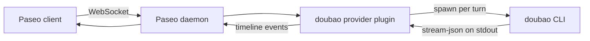

<div align="center">
  
  <h1>doubao-cli-paseo-provider</h1>
  <p><strong>Use the Doubao CLI from Paseo</strong> — streaming turns, native session resume, and a model catalogue discovered from the CLI itself.</p>
  <p>
    <a href="https://github.com/exposir/doubao-cli-paseo-provider/actions/workflows/ci.yml"></a>
    
    
    
  </p>
  <p><a href="README.zh-CN.md">简体中文</a> · <a href="docs/PRODUCTION.md">Production notes</a> · <a href="docs/TESTING.md">Testing</a></p>
</div>

---

## Why this exists

Paseo does not ship a Doubao provider. The CLI has an ACP mode, but the protocol that actually
fits headless orchestration is `--output-format stream-json`: it carries text deltas, the final
message, the native session id and the terminal result in one stream.

This plugin consumes that stream directly. One process per turn, no ACP handshake, no capability
probing loop, and session resume that uses the id Doubao itself assigned.

## Features

| | |
| --- | --- |
| **Streaming turns** | `stream_event` deltas are coalesced into a small number of timeline updates, not one per token. |
| **Native resume** | The `session_id` from the `system` event is persisted and passed back as `--resume`. |
| **Dynamic catalogue** | Models, per-model effort levels and defaults come from `doubao model list --output-format json`. No hard-coded names, no locale-dependent parsing. |
| **Session discovery** | `doubao --list --output-format json` is exposed as Paseo's session list. |
| **Tool cards** | `tool_use` / `tool_result` become Paseo tool cards (shell, read, write, edit, search, fetch) with running/completed/failed states. |
| **No global queue** | A long turn never blocks catalogue reads, configuration changes or other sessions. |
| **Resource guards** | Concurrency cap, turn deadline, stall watchdog, byte caps and a free-disk floor. |
| **Bounded discovery** | Every probe has a timeout, so a broken CLI cannot hang the provider catalogue. |
| **Clean teardown** | Children are tracked, signalled on exit, and swept on the next start after a hard kill. |

## How it works



Each turn is one CLI process:

```bash
doubao --resume <native-id> -p "<prompt>" --output-format stream-json \
       -C <workspace> --model <id> --effort <level> --permission-mode <mode>
```

## Requirements

| Requirement | Version |
| --- | --- |
| Paseo | >= 0.15.0 (typechecked against 0.15.0 and 0.17.6) |
| Node | >= 22 |
| Doubao CLI | installed and logged in (`doubao auth status` exits 0) |

## Install

```bash
git clone https://github.com/exposir/doubao-cli-paseo-provider.git
cd doubao-cli-paseo-provider
npm install
paseo plugin install .
```

Verify:

```bash
paseo plugin ls
paseo run --provider doubao "Reply with exactly: PONG"
```

## Usage

```bash
# one shot
paseo run --provider doubao "Explain the architecture of this repository"

# pick a model and a reasoning level
paseo run --provider doubao --model <model-id> --thinking max "Refactor the data layer"

# continue an agent
paseo send <agent-id> "Add tests for the change"
```

Model ids and effort levels are whatever the CLI reports for your account:

```bash
doubao model list --output-format json
```

## Resource guards

Every limit is enforced in the provider, so a runaway turn cannot take the daemon's memory or
the host's disk with it.

| Limit | Default | When hit |
| --- | --- | --- |
| `maxConcurrentTurns` | 2 | extra prompt fails with `TOO_MANY_TURNS` |
| `maxTurnMs` | 30 min | turn stops with `TURN_TIMEOUT` |
| `stallTimeoutMs` | 5 min | silent turn stops with `TURN_STALLED` |
| `maxAssistantBytes` | 4 MiB | text is cut at a UTF-8 boundary and marked |
| `maxStderrBytes` | 64 KiB | error detail is cut and marked |
| `maxPromptBytes` | 1 MiB | rejected with `PROMPT_TOO_LARGE` |
| `minFreeDiskBytes` | 512 MiB | refused with `DISK_LOW` |

Tune without rebuilding:

```bash
export DOUBAO_PASEO_MAX_TURNS=1
export DOUBAO_PASEO_MIN_FREE_DISK_MB=1024
```

| Environment variable | Limit |
| --- | --- |
| `DOUBAO_PASEO_MAX_TURNS` | `maxConcurrentTurns` |
| `DOUBAO_PASEO_MAX_TURN_MS` | `maxTurnMs` |
| `DOUBAO_PASEO_STALL_MS` | `stallTimeoutMs` |
| `DOUBAO_PASEO_MAX_TEXT_BYTES` | `maxAssistantBytes` |
| `DOUBAO_PASEO_MAX_STDERR_BYTES` | `maxStderrBytes` |
| `DOUBAO_PASEO_MAX_PROMPT_BYTES` | `maxPromptBytes` |
| `DOUBAO_PASEO_MIN_FREE_DISK_MB` | `minFreeDiskBytes` |

## Security

The plugin does not sandbox Doubao. In headless `-p` mode the CLI auto-approves tool calls
regardless of `--permission-mode`: both `ask_risky` and `ask_always` were observed writing files
without prompting (doubao 2.38.4, no TTY). The flag is forwarded for compatibility; Paseo does
not enforce an approval gate.

If you need isolation, run the daemon or the workspace in a container, a sandbox, or under a
dedicated user. Do not point this provider at a directory where unattended writes are
unacceptable.

Shell commands that would start another Doubao or Paseo turn (`doubao -p`, `doubao --resume`,
`paseo run/send/...`) are detected when the tool call starts: the card is marked canceled and the
turn stops with a warning instead of deadlocking.

## Development

```bash
npm install
npm run typecheck
npm test          # unit tests, no CLI needed
npm run test:live # unit tests + real CLI (one short completion)
npm run e2e       # throwaway daemon: install, run, resume
npm run e2e:draw  # three-turn drawing flow
npm run soak      # 20 real turns: RSS, leaked processes, restart resume
npm run scenarios # everyday tasks, image generation, long task, concurrency cap
```

| Suite | Covers |
| --- | --- |
| `stream.test.ts` | NDJSON framing, CRLF, split UTF-8, deltas, result precedence, caps |
| `catalog.test.ts` | model list mapping, duplicate ids, TTL, single-flight, failure fallback |
| `sessions.test.ts` | `--list` mapping, persisted native ids |
| `args.test.ts` | argument order for fresh and resumed turns |
| `prompt.test.ts` | text, image, file, PR/issue, review formatting |
| `errors.test.ts` | stderr cleanup, error codes |
| `session.test.ts` | state machine against a fake CLI: resume, interrupts, timeouts, close |
| `provider.test.ts` | registration, capabilities, dispatch, concurrency, failure paths |
| `cli.test.ts` | last-protocol-line extraction |
| `limits.test.ts` | env overrides, invalid values, UTF-8 truncation |
| `performance.test.ts` | 20k deltas stay linear |
| `reaper.test.ts` | orphan sweep touches marked processes only |

See [docs/TESTING.md](docs/TESTING.md) for the full matrix and environment variables.

## Compatibility and status

- Paseo plugin SDK: typechecked against **0.15.0** and **0.17.6**; daemon E2E on **0.17.6**.
- Doubao CLI: **2.38.4**.
- Soak: **20 turns**, daemon RSS flat (166 MB peak, 0 MB growth), zero leaked processes,
  resume after restart.
- Interrupt: a real image turn stopped mid-flight, zero Doubao processes left, agent back to idle.

### Known limitations

- Tool calls render as cards, but their results are text; structured diffs only appear when the CLI returns one.
- The CLI service can kill a single turn around 90–100 s when one model request gets large. Keep prompts focused or split them; provider-analysis prompts get a safety note that caps reading.
- Headless permission modes are advisory (see Security).
- The catalogue is cached for 5 minutes; account model changes can lag.
- Interrupt sends `SIGINT`, then `SIGKILL` after 3 seconds.

## Troubleshooting

| Symptom | Cause | Fix |
| --- | --- | --- |
| `plugin ls` shows `disabled` | plugins globally off | `pluginsEnabled: true` in the daemon config |
| `Expected a relative path to a PNG` | manifest points at an SVG | point `icon` at `icon.png` (`node scripts/make-icon.mjs`) |
| `Unrecognized key: "listen"` | wrong config nesting | the key is `daemon.listen` |
| Follow-up loses context | native id not persisted | check for a `session.persistence` event |
| `Workspace not found` | stale workspace id | `--new-workspace local` in a fresh project |
| Turn fails with `DISK_LOW` | below the free-space floor | free space or lower `DOUBAO_PASEO_MIN_FREE_DISK_MB` |

## License

[MIT](LICENSE)
