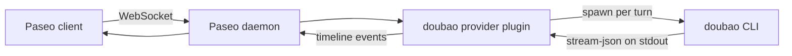

<div align="center">
  
  <h1>doubao-cli-paseo-provider</h1>
  <p><strong>Use the Doubao CLI from Paseo</strong> — streaming turns, native session resume, and a model catalogue discovered from the CLI itself.</p>
  <p>
    <a href="https://github.com/exposir/doubao-cli-paseo-provider/actions/workflows/ci.yml"></a>
    
    
    
  </p>
  <p><a href="README.zh-CN.md">简体中文</a> · <a href="docs/PRODUCTION.md">Production notes</a> · <a href="docs/TESTING.md">Testing</a></p>
</div>

---

## Why this exists

This plugin connects Paseo to Doubao CLI. The default `stream-json` transport runs one
process per turn and resumes with the session ID assigned by Doubao. The optional native ACP
transport connects to `doubao acp serve` for interactive approval, slash commands and cloud
skills, reasoning, plans, and conversation replay.

## Features

| | |
| --- | --- |
| **Streaming turns** | `stream_event` deltas are coalesced into a small number of timeline updates, not one per token. |
| **Native resume** | `stream-json` continues with `--resume`. ACP restores bound cloud sessions with `session/load`. |
| **Native ACP parity** | Opt-in ACP supports image files for Doubao Read vision, interactive questions, workspace text callbacks and `systemPrompt`. |
| **Dynamic catalogue** | Models, per-model effort levels and defaults come from `doubao model list --output-format json`. No hard-coded names, no locale-dependent parsing. |
| **Session discovery** | Paseo receives sessions from `doubao --list --output-format json` or ACP `session/list`. |
| **Tool cards** | `tool_use` / `tool_result` become Paseo tool cards (shell, read, write, edit, search, fetch) with running/completed/failed states. |
| **No global queue** | A long turn never blocks catalogue reads, configuration changes or other sessions. |
| **Resource guards** | Concurrency cap, turn deadline, stall watchdog, byte caps and a free-disk floor. |
| **Bounded discovery** | Every probe has a timeout, so a broken CLI cannot hang the provider catalogue. |
| **Clean teardown** | Children are tracked, signalled on exit, and swept on the next start after a hard kill. |

## How it works



In the default transport, each turn is one CLI process with the prompt sent over stdin (`-p -`).

```bash
doubao --resume <native-id> -p - --output-format stream-json \
       -C <workspace> --model <id> --effort <level> --permission-mode <mode>
```

## Requirements

| Requirement | Version |
| --- | --- |
| Paseo | >= 0.15.0 (typechecked against 0.15.0 and 0.17.6) |
| Node | >= 22 |
| Doubao CLI | installed and logged in (`doubao auth status` exits 0) |

## Install

```bash
git clone https://github.com/exposir/doubao-cli-paseo-provider.git
cd doubao-cli-paseo-provider
npm install
paseo plugin install .
```

Verify:

```bash
paseo plugin ls
paseo run --provider doubao "Reply with exactly: PONG"
```

## Usage

```bash
# one shot
paseo run --provider doubao "Explain the architecture of this repository"

# pick a model and a reasoning level
paseo run --provider doubao --model <model-id> --thinking max "Refactor the data layer"

# continue an agent
paseo send <agent-id> "Add tests for the change"
```

Model ids and effort levels are whatever the CLI reports for your account:

```bash
doubao model list --output-format json
```

## Resource guards

Every limit is enforced in the provider, so a runaway turn cannot take the daemon's memory or
the host's disk with it.

| Limit | Default | When hit |
| --- | --- | --- |
| `maxConcurrentTurns` | 2 | shared across both transports and all connections. Extra prompts fail with `TOO_MANY_TURNS` |
| `maxTurnMs` | 30 min | turn stops with `TURN_TIMEOUT` |
| `stallTimeoutMs` | 5 min | silent turn stops with `TURN_STALLED`. ACP pauses this timer while approval is pending |
| `idleRuntimeMs` (ACP) | 5 min | idle CLI process exits. The session reconnects on the next prompt or configuration change |
| `maxAssistantBytes` | 4 MiB | output is cut at a UTF-8 boundary and marked. ACP counts replies and reasoning together |
| `maxStderrBytes` | 64 KiB | error detail is cut and marked |
| `maxPromptBytes` | 1 MiB / 262,144 code points | rejected with `PROMPT_TOO_LARGE` |
| `minFreeDiskBytes` | 512 MiB | refused with `DISK_LOW` |

Tool card output is capped at 64 KiB per call, so a chatty command cannot bloat the daemon.

Tune without rebuilding:

```bash
export DOUBAO_PASEO_MAX_TURNS=1
export DOUBAO_PASEO_MIN_FREE_DISK_MB=1024
```

| Environment variable | Limit |
| --- | --- |
| `DOUBAO_PASEO_TRANSPORT` | `stream-json` (default) or `acp` (`doubao acp serve`) |
| `DOUBAO_PASEO_MAX_TURNS` | `maxConcurrentTurns` |
| `DOUBAO_PASEO_MAX_TURN_MS` | `maxTurnMs` |
| `DOUBAO_PASEO_STALL_MS` | `stallTimeoutMs` |
| `DOUBAO_PASEO_IDLE_MS` | `idleRuntimeMs` (ACP only, `0` disables idle reclamation) |
| `DOUBAO_PASEO_MAX_TEXT_BYTES` | `maxAssistantBytes` |
| `DOUBAO_PASEO_MAX_STDERR_BYTES` | `maxStderrBytes` |
| `DOUBAO_PASEO_MAX_PROMPT_BYTES` | `maxPromptBytes` |
| `DOUBAO_PASEO_MIN_FREE_DISK_MB` | `minFreeDiskBytes` |

### ACP mode (opt-in)

Set `DOUBAO_PASEO_TRANSPORT=acp` in the daemon environment (or use
`createDoubaoProvider({ transport: "acp" })` when embedding the provider) to use the self-owned
Doubao-native ACP v1 driver. It speaks JSON-RPC 2.0 directly to `doubao acp serve` (2.38.4)
with zero extra runtime dependencies and supports both Paseo **0.15.0** and **0.17.6**. Launch
wrapping is available when the host offers `session.launch_wrap`.

```bash
# run E2E against a throwaway daemon using ACP
DOUBAO_PASEO_TRANSPORT=acp npm run e2e

# approve interactive tool requests in another terminal
paseo permit ls
paseo permit allow <agent-id>
```

- Commands such as `/compact` and account skills appear as soon as a new session is ready.
  ACP also forwards `stdio` MCP servers, interactive tool approvals (with command/path summaries
  in `paseo permit ls`), reasoning, plans, and tool cards (`shell`, `read`, `write`, `edit`,
  `search`, `fetch`, `think`, `switch_mode`).
- After five minutes of inactivity, the provider reclaims the ACP process (~150 MB typical
  RSS). The next prompt or configuration change loads a bound session without replay and reapplies
  its selected configuration (skipping unavailable effort levels on fixed-effort models). A
  zero-turn session gets a new native ID because Doubao persists it after its first completed turn.
- Interrupts, timeouts, and session close resolve pending approvals/questions and send
  `session/cancel`. An unresponsive turn gets 2.5 seconds before the provider kills the local
  POSIX process group. Startup and crash failures include bounded stderr.
- The negotiated `prompt.image` capability turns image attachments into session-private
  temporary files (up to 20 MiB decoded per image, `0600` files inside a `0700` directory,
  cleaned up on session close and process exit) referenced for Doubao's native Read tool. The
  wire carries text and `resource_link` blocks, never an ACP `image` block.
- `elicitation/create` maps to Paseo interactive questions (`kind: "question"`), including
  single-select, multi-select, free text and custom `:text` answers. `fs/read_text_file` serves
  bounded workspace text, while `resource_link` attachments share a cumulative 64 KiB prompt
  budget and safely fall back to text summaries for binary, oversized, or out-of-workspace files.
- Built-in commands (`init`, `review`, `compact`, `agent-new`) are classified separately from
  cloud skills (`command` vs `skill`). A new unbound session injects `systemPrompt` once on its
  first plain prompt (keeping the user timeline clean); slash commands and resumed sessions skip
  that injection.
- Provider metadata exposes the documentation URL, install URL and a version-aware
  `installation.inspect` probe.

## Security

Run the plugin with the permissions you want to grant to the Doubao CLI. In headless `-p` mode,
workspace operations execute without interactive confirmation (both `ask_risky` and `ask_always`
were observed writing files in the workspace without prompting on doubao 2.38.4), while actions
that trigger a server-side approval request are automatically denied by the CLI and surfaced via
`permission_denials`.

If you need isolation, run the daemon or the workspace in a container, a sandbox, or under a
dedicated user. Do not point this provider at a directory where unattended writes are
unacceptable.

In `stream-json`, the provider stops a turn if its tool call would start a nested Doubao or Paseo
turn (`doubao ... -p`, `doubao ... --resume`, or `paseo run/send/...`) and marks the tool card as
canceled. A dismissible banner at session start explains how approvals work. Set
`DOUBAO_PASEO_SUPPRESS_NOTICES=1` to hide it in controlled environments.

## Development

```bash
npm install
npm run typecheck
npm test          # unit tests, no CLI needed
npm run test:live # unit tests + real CLI (one short completion)
npm run e2e       # throwaway daemon: install, run, resume
npm run e2e:draw  # three-turn drawing flow
npm run soak      # 20 real turns: RSS, leaked processes, restart resume
npm run scenarios # everyday tasks, image generation, long task, concurrency cap
```

| Suite | Covers |
| --- | --- |
| `stream.test.ts` | NDJSON framing, CRLF, split UTF-8, deltas, result precedence, caps |
| `catalog.test.ts` | model list mapping, duplicate ids, TTL, single-flight, failure fallback |
| `sessions.test.ts` | `--list` mapping, persisted native ids |
| `args.test.ts` | argument order for fresh and resumed turns |
| `prompt.test.ts` | text, image, file, PR/issue, review formatting |
| `errors.test.ts` | stderr cleanup, error codes |
| `session.test.ts` | state machine against a fake CLI: resume, interrupts, timeouts, close |
| `provider.test.ts` | registration, capabilities, dispatch, concurrency, failure paths |
| `cli.test.ts` | last-protocol-line extraction |
| `limits.test.ts` | env overrides, invalid values, UTF-8 truncation |
| `performance.test.ts` | 20k deltas stay linear |
| `reaper.test.ts` | orphan sweep touches marked processes only |
| `tools.test.ts` | tool_use/tool_result extraction, tool-card details, output caps |
| `acp.test.ts` | native JSON-RPC and stdio lifecycle, images, questions, filesystem callbacks, command kinds, system prompts, installation metadata, guards and process cleanup |

See [docs/TESTING.md](docs/TESTING.md) for the full matrix and environment variables.

## Compatibility and status

- Paseo plugin SDK: verified (`typecheck + test`) against **0.15.0** and **0.17.6**; daemon E2E verified on **0.17.4** and **0.17.6** (both `stream-json` and `acp`).
- Doubao CLI: **2.38.4** (live cloud verified on Linux).
- Tests: **233 unit** tests (including **55 ACP tests**) plus **4 live cloud tests** (**237/237** passing with `DOUBAO_LIVE=1`).
- Live ACP verification (Doubao 2.38.4 + Paseo 0.17.6): dual-transport daemon E2E, multi-step web search + 15 consecutive interactive `Bash` approvals via `paseo permit`, real `elicitation/create` single-select question round-trip, real PNG vision via `prompt.image`, workspace `resource_link` + `fs/read_text_file`, `systemPrompt` injection, idle eviction + transparent `session/load` hot reload, and live `session/cancel` interrupt with zero orphan processes.
- Scenarios (`stream-json`): **8/8** — quick answer, news search, file write, code reading, multi-turn, image, long task with a concurrency probe.
- Soak (`stream-json`): **20 turns**, daemon RSS flat (166 MB peak, 0 MB growth), zero leaked processes, resume after restart.
- Interrupt: a real image turn stopped mid-flight, zero Doubao processes left, agent back to idle.

### Known limitations

- Tool calls render as cards, but their results are text; structured diffs only appear when the CLI returns one.
- The CLI service can kill a single turn around 90–100 s when one model request gets large. Keep prompts focused or split them.
- The `stream-json` transport cannot route interactive approvals through Paseo. Use ACP for
  approval prompts (see Security).
- In `stream-json`, images remain text summaries. ACP materializes them so Doubao's native
  Read tool can inspect the file with vision.
- Upstream Doubao CLI 2.38.4 ACP server boundaries: `usage_update` (token/context metrics),
  `prompt.steer` (mid-turn concurrent prompt returns `-32901 busy`), `session/revert` /
  `session/archive`, and HTTP/SSE MCP servers (`mcpCapabilities: {}`) are not yet exposed by the
  CLI itself.
- The catalogue is cached for 5 minutes; account model changes can lag.
- On `stream-json`, interrupt sends `SIGINT`, then `SIGKILL` after 3 seconds.

## Troubleshooting

| Symptom | Cause | Fix |
| --- | --- | --- |
| `plugin ls` shows `disabled` | plugins globally off | `pluginsEnabled: true` in the daemon config |
| `Expected a relative path to a PNG` | manifest points at an SVG | point `icon` at `icon.png` (`node scripts/make-icon.mjs`) |
| `Unrecognized key: "listen"` | wrong config nesting | the key is `daemon.listen` |
| Follow-up loses context | native id not persisted | check for a `session.persistence` event |
| `Workspace not found` | stale workspace id | `--new-workspace local` in a fresh project |
| Turn fails with `DISK_LOW` | below the free-space floor | free space or lower `DOUBAO_PASEO_MIN_FREE_DISK_MB` |
| `SIGNAL_SIGKILL` on a long analysis | one request exceeded the CLI service budget | split the prompt into smaller steps |
| A `stream-json` failure includes `log_id` | Doubao returned a cloud trace ID | include the ID when investigating the failure |

## License

[MIT](LICENSE)
