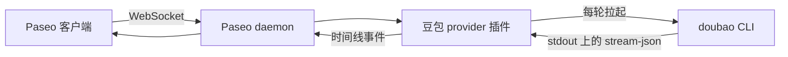

<div align="center">
  
  <h1>doubao-cli-paseo-provider</h1>
  <p><strong>在 Paseo 里使用豆包 CLI</strong>：流式输出、原生会话续聊、模型列表从 CLI 自动发现。</p>
  <p>
    <a href="https://github.com/exposir/doubao-cli-paseo-provider/actions/workflows/ci.yml"></a>
    
    
    
  </p>
  <p><a href="README.md">English</a> · <a href="docs/PRODUCTION.md">生产说明</a> · <a href="docs/TESTING.md">测试文档</a></p>
</div>

---

## 为什么做这个

这个插件将豆包 CLI 接入 Paseo。默认的 `stream-json` 每轮启动一个进程，使用豆包分配的会话 ID
续聊。可选的原生 ACP 驱动连接 `doubao acp serve`，提供交互式审批、斜杠命令、云端 Skills、思考流、
计划和历史回放。

## 特性

| | |
| --- | --- |
| **流式输出** | `stream_event` 增量合并为少量时间线更新，而不是每个 token 一条。 |
| **原生续聊** | `stream-json` 使用 `--resume`。ACP 使用 `session/load` 恢复已绑定的云端会话。 |
| **原生 ACP 能力** | 可选 ACP 支持图片文件供豆包 Read 视觉读取、交互问题、工作区文本回调和 `systemPrompt`。 |
| **动态目录** | 模型、每个模型的 effort 档位和默认值来自 `doubao model list --output-format json`，不硬编码、不依赖中英文文案。 |
| **会话发现** | Paseo 通过 `doubao --list --output-format json` 或 ACP `session/list` 获取会话。 |
| **工具卡片** | `tool_use` / `tool_result` 映射为 Paseo 的 shell、read、write、edit、search 卡片，带 running/completed/failed 状态。 |
| **无全局队列** | 一个长任务不会阻塞目录读取、配置修改或其它会话。 |
| **资源护栏** | 并发上限、单轮时限、停滞看门狗、输出字节上限、磁盘余量下限。 |
| **探测有超时** | CLI 卡死不会拖住 Paseo 的 provider 目录。 |
| **干净退出** | 子进程被登记、退出时回收；daemon 被硬杀后，下次启动会扫掉残留。 |

## 工作原理



默认模式下每轮启动一个 CLI 进程，提示词通过标准输入（`-p -`）传入。

```bash
doubao --resume <原生id> -p - --output-format stream-json \
       -C <工作区> --model <模型id> --effort <档位> --permission-mode <模式>
```

## 前置要求

| 项 | 版本 |
| --- | --- |
| Paseo | >= 0.15.0（已对 0.15.0 和 0.17.6 做类型检查） |
| Node | >= 22 |
| 豆包 CLI | 已安装并登录（`doubao auth status` 退出码为 0） |

## 安装

```bash
git clone https://github.com/exposir/doubao-cli-paseo-provider.git
cd doubao-cli-paseo-provider
npm install
paseo plugin install .
```

验证：

```bash
paseo plugin ls
paseo run --provider doubao "只回复：PONG"
```

## 使用

```bash
# 单次任务
paseo run --provider doubao "解释一下这个仓库的架构"

# 指定模型和推理档位
paseo run --provider doubao --model <模型id> --thinking max "重构数据层"

# 继续已有 agent
paseo send <agent-id> "给这次改动补测试"
```

模型 id 和档位以你账号下 CLI 返回的为准：

```bash
doubao model list --output-format json
```

## 资源护栏

所有限制都在 provider 内强制执行，避免失控任务拖垮 daemon 的内存或主机的磁盘。

| 限制 | 默认 | 触发后 |
| --- | --- | --- |
| `maxConcurrentTurns` | 2 | 两种传输及所有连接共用上限，超出时返回 `TOO_MANY_TURNS` |
| `maxTurnMs` | 30 分钟 | 终止本轮，`TURN_TIMEOUT` |
| `stallTimeoutMs` | 5 分钟 | 无输出则终止，返回 `TURN_STALLED`。ACP 等待审批时暂停停滞计时 |
| `idleRuntimeMs`（ACP） | 5 分钟 | 回收空闲 CLI 进程，下次发消息或改配置时自动恢复 |
| `maxAssistantBytes` | 4 MiB | 在 UTF-8 边界截断并标记，ACP 的回复和思考共用上限 |
| `maxStderrBytes` | 64 KiB | 错误详情截断并标记 |
| `maxPromptBytes` | 1 MiB / 262,144 码点 | 启动前拒绝，`PROMPT_TOO_LARGE` |
| `minFreeDiskBytes` | 512 MiB | 拒绝本轮，`DISK_LOW` |

单次工具调用的卡片输出上限为 64 KiB，避免一条命令把 daemon 撑大。

无需重新构建即可调整：

```bash
export DOUBAO_PASEO_MAX_TURNS=1
export DOUBAO_PASEO_MIN_FREE_DISK_MB=1024
```

| 环境变量 | 对应限制 |
| --- | --- |
| `DOUBAO_PASEO_TRANSPORT` | `stream-json`（默认）或 `acp`（`doubao acp serve`） |
| `DOUBAO_PASEO_MAX_TURNS` | `maxConcurrentTurns` |
| `DOUBAO_PASEO_MAX_TURN_MS` | `maxTurnMs` |
| `DOUBAO_PASEO_STALL_MS` | `stallTimeoutMs` |
| `DOUBAO_PASEO_IDLE_MS` | `idleRuntimeMs`（仅 ACP，`0` 禁用空闲回收） |
| `DOUBAO_PASEO_MAX_TEXT_BYTES` | `maxAssistantBytes` |
| `DOUBAO_PASEO_MAX_STDERR_BYTES` | `maxStderrBytes` |
| `DOUBAO_PASEO_MAX_PROMPT_BYTES` | `maxPromptBytes` |
| `DOUBAO_PASEO_MIN_FREE_DISK_MB` | `minFreeDiskBytes` |

### ACP 模式（可选）

在 daemon 环境变量中设置 `DOUBAO_PASEO_TRANSPORT=acp`（或在嵌入时调用
`createDoubaoProvider({ transport: "acp" })`），即可启用自研豆包原生 ACP v1 驱动。它零新增运行依赖，直接通过 JSON-RPC 2.0 对接 `doubao acp serve`（2.38.4），同时兼容 Paseo **0.15.0** 和 **0.17.6**。宿主提供 `session.launch_wrap` 时可包装会话启动命令。

```bash
# 用 ACP 模式跑临时 daemon 端到端验证
DOUBAO_PASEO_TRANSPORT=acp npm run e2e

# 在另一终端查看并放行交互式工具审批
paseo permit ls
paseo permit allow <agent-id>
```

- 新会话就绪时即可看到 `/compact` 等命令和账号 Skills。ACP 同时支持 `stdio` MCP 透传、交互式工具审批（`paseo permit ls` 展示实际命令/路径摘要）、思考流、计划和完整工具卡片（`shell`、`read`、`write`、`edit`、`search`、`fetch`、`think`、`switch_mode`）。
- 默认空闲五分钟后回收进程（典型 RSS 约 150 MB）。下次发消息或改配置时，已绑定云端的会话自动加载并恢复所选配置（固定 effort 模型自动跳过不适用档位），跳过历史回放。零轮会话会重建，豆包在首轮完成后才持久化原生 ID。
- 中断、超时和关闭会话时，先结束待审批请求与待答表单并发送 `session/cancel`。若云端在 2.5 秒内仍无响应，驱动会强杀本地 POSIX 进程组。启动失败和异常退出会附上有字节上限的 stderr。
- 协商 `prompt.image` 后，图片附件会写入会话私有临时文件（单图解码上限 20 MiB，目录权限 `0700`、文件权限 `0600`，会话关闭及进程退出自动清理），以文本路径交给豆包原生 Read 工具以视觉方式读取。线上内容只使用 text 和 `resource_link`，不会发送 ACP `image` 块。
- `elicitation/create` 映射为 Paseo 原生交互问题（`kind: "question"`），支持单选、多选、自由文本和自定义 `:text` 回答。`fs/read_text_file` 在 64 KiB 内读取工作区文本，多个 `resource_link` 共用同一轮 64 KiB 累计预算，超限、二进制或工作区外文件自动安全回退为文本摘要。
- `init`、`review`、`compact`、`agent-new` 与云端 Skills 会分别标记为 `command` 和 `skill`。新未绑定会话的首条普通消息注入一次 `systemPrompt`（保持用户时间线干净），斜杠命令和续聊会话会跳过注入。
- provider 元数据提供文档 URL、安装 URL 和可识别版本号的 `installation.inspect`。

## 安全边界

插件不提供沙箱。无头 `-p` 模式下，Paseo 无法拦截工具审批：工作区内的常规操作会在没有确认的
情况下直接执行（实测 doubao 2.38.4 无 TTY 时 `ask_risky` 和 `ask_always` 都会直接写工作区文件），
而触发服务端交互审批的操作会被 CLI 自动拒绝并在结果中返回 `permission_denials`。

需要隔离时，把 daemon 或工作区放进容器、沙箱或独立用户下运行；不要把它指向不能接受无人值守
写入的目录。新会话会有一条可关闭的 warning 说明这一点；受控环境可用
`DOUBAO_PASEO_SUPPRESS_NOTICES=1` 关掉。

## 开发

```bash
npm install
npm run typecheck
npm test          # 单元测试，不需要 CLI
npm run test:live # 单元测试 + 真实 CLI（一次很短的任务）
npm run e2e       # 临时 daemon：安装、运行、续聊
npm run e2e:draw  # 三轮绘画流程
npm run soak      # 20 轮真实任务：RSS、孤儿进程、重启续聊
npm run scenarios # 日常任务、图片、长任务、并发上限
```

| 测试 | 覆盖 |
| --- | --- |
| `stream.test.ts` | NDJSON 拆包、CRLF、UTF-8 跨包、增量、result 优先级、截断 |
| `catalog.test.ts` | 模型列表映射、重复 id、TTL、并发合并、失败回退 |
| `sessions.test.ts` | `--list` 映射、持久化 id |
| `args.test.ts` | 新会话与续聊的参数顺序 |
| `prompt.test.ts` | 文本、图片、文件、PR/Issue、Review 格式化 |
| `errors.test.ts` | stderr 清理、错误码 |
| `session.test.ts` | 假 CLI 驱动的状态机：续聊、中断、超时、关闭 |
| `provider.test.ts` | 注册、能力协商、分发、并发、异常分支 |
| `cli.test.ts` | 协议行提取 |
| `limits.test.ts` | 环境变量、非法值、UTF-8 截断 |
| `performance.test.ts` | 2 万 delta 保持线性 |
| `reaper.test.ts` | 只回收带标记的孤儿进程 |
| `tools.test.ts` | tool_use/tool_result 提取、工具卡片详情、输出封顶 |
| `acp.test.ts` | 原生 JSON-RPC、stdio 生命周期、图片、问题、文件系统回调、命令分类、系统提示词、安装元数据、资源护栏和进程回收 |

完整矩阵和环境变量见 [docs/TESTING.md](docs/TESTING.md)。

## 兼容性与状态

- Paseo 插件 SDK：已对 **0.15.0** 和 **0.17.6** 完成类型检查与全量单测；daemon E2E 已在 **0.17.4** 和 **0.17.6**（`stream-json` 与 `acp` 双传输）验证通过。
- 豆包 CLI：**2.38.4**（Linux 实网云端全链路验证）。
- 测试共 **233 个单测**（含 **55 个 ACP 用例**）+ **4 个真实云端 live 用例**（`DOUBAO_LIVE=1` 下 **237/237** 全部通过）。
- 实网 ACP 深度验证（豆包 2.38.4 + Paseo 0.17.6）：双传输 daemon E2E、多轮联网搜新闻 + 15 次连续 `Bash` 审批（`paseo permit`）、真实 `elicitation/create` 单选表单回环、真实 PNG 视觉识别（`prompt.image`）、工作区 `resource_link` + `fs/read_text_file`、`systemPrompt` 注入、空闲回收后 `session/load` 透明热重载，以及实网 `session/cancel` 中断且零孤儿进程。
- 场景（`stream-json`）：**8/8** 通过——快问快答、新闻搜索、写文件、读代码、多轮回忆、图片、长任务 + 并发探针。
- Soak（`stream-json`）：**20 轮**，daemon RSS 平稳（峰值 166 MB，增长 0 MB），零残留进程，重启后仍能续聊。
- 中断：真实图片任务中途停止，豆包进程清零，agent 回到 idle。

### 已知限制

- 工具调用已经是卡片，但结果是文本；只有 CLI 返回 diff 时才展示结构化 diff。
- 单个模型请求过大时，CLI 服务会在 90–100 秒左右杀掉整轮，请拆分提示词。
- `stream-json` 无头模式无法通过 Paseo 做交互式权限审批。需要审批弹窗时使用 ACP（见“安全边界”）。
- `stream-json` 中图片仍是文本摘要。ACP 会把图片物化为本地文件，供豆包原生 Read
  工具以视觉方式读取。
- 豆包 CLI 2.38.4 自身 ACP 服务端上限：`usage_update`（token/上下文指标）、`prompt.steer`（同会话并发 prompt 返回 `-32901 busy`）、`session/revert`/`archive` 以及 HTTP/SSE MCP（`mcpCapabilities: {}`）需等待上游 CLI 支持。
- 模型目录缓存 5 分钟，账号模型变更会有延迟。
- `stream-json` 中断先发 `SIGINT`，3 秒后升级为 `SIGKILL`。

## 排错

| 现象 | 原因 | 处理 |
| --- | --- | --- |
| `plugin ls` 显示 `disabled` | 插件全局关闭 | 配置 `pluginsEnabled: true` |
| `Expected a relative path to a PNG` | 图标用了 SVG | 指向 `icon.png`（`node scripts/make-icon.mjs`） |
| `Unrecognized key: "listen"` | 配置层级错误 | 应为 `daemon.listen` |
| 续聊丢上下文 | 原生 id 没持久化 | 检查是否出现 `session.persistence` 事件 |
| `Workspace not found` | 工作区 id 过期 | 在新项目里用 `--new-workspace local` |
| 报 `DISK_LOW` | 低于磁盘余量下限 | 清理空间或调低 `DOUBAO_PASEO_MIN_FREE_DISK_MB` |
| 长分析报 `SIGNAL_SIGKILL` | 单个请求超过 CLI 服务时限 | 拆分提示词分步执行 |
| `stream-json` 失败中包含 `log_id` | 豆包返回了云端请求追踪 ID | 排查时附上此 ID |

## 许可证

[MIT](LICENSE)
