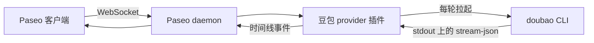

<div align="center">
  
  <h1>doubao-cli-paseo-provider</h1>
  <p><strong>在 Paseo 里使用豆包 CLI</strong>：流式输出、原生会话续聊、模型列表从 CLI 自动发现。</p>
  <p>
    <a href="https://github.com/exposir/doubao-cli-paseo-provider/actions/workflows/ci.yml"></a>
    
    
    
  </p>
  <p><a href="README.md">English</a> · <a href="docs/PRODUCTION.md">生产说明</a> · <a href="docs/TESTING.md">测试文档</a></p>
</div>

---

## 为什么做这个

Paseo 没有内置豆包 Provider。豆包 CLI 虽然有 ACP 模式，但真正适合无头编排的是
`--output-format stream-json`：文本增量、最终消息、原生 session id、终态结果，全在同一条流里。

这个插件直接消费这条流：每轮只起一个进程，没有 ACP 握手和反复探测，续聊用的是豆包自己分配的
session id。

## 特性

| | |
| --- | --- |
| **流式输出** | `stream_event` 增量合并为少量时间线更新，而不是每个 token 一条。 |
| **原生续聊** | 从 `system` 事件拿到 `session_id` 并持久化，下一轮用 `--resume` 接上。 |
| **动态目录** | 模型、每个模型的 effort 档位和默认值来自 `doubao model list --output-format json`，不硬编码、不依赖中英文文案。 |
| **会话发现** | `doubao --list --output-format json` 映射为 Paseo 的会话列表。 |
| **无全局队列** | 一个长任务不会阻塞目录读取、配置修改或其它会话。 |
| **资源护栏** | 并发上限、单轮时限、停滞看门狗、输出字节上限、磁盘余量下限。 |
| **探测有超时** | CLI 卡死不会拖住 Paseo 的 provider 目录。 |
| **干净退出** | 子进程被登记、退出时回收；daemon 被硬杀后，下次启动会扫掉残留。 |

## 工作原理



每轮就是一个 CLI 进程：

```bash
doubao --resume <原生id> -p "<提示词>" --output-format stream-json \
       -C <工作区> --model <模型id> --effort <档位> --permission-mode <模式>
```

## 前置要求

| 项 | 版本 |
| --- | --- |
| Paseo | >= 0.15.0（已对 0.15.0 和 0.17.6 做类型检查） |
| Node | >= 22 |
| 豆包 CLI | 已安装并登录（`doubao auth status` 退出码为 0） |

## 安装

```bash
git clone https://github.com/exposir/doubao-cli-paseo-provider.git
cd doubao-cli-paseo-provider
npm install
paseo plugin install .
```

验证：

```bash
paseo plugin ls
paseo run --provider doubao "只回复：PONG"
```

## 使用

```bash
# 单次任务
paseo run --provider doubao "解释一下这个仓库的架构"

# 指定模型和推理档位
paseo run --provider doubao --model <模型id> --thinking max "重构数据层"

# 继续已有 agent
paseo send <agent-id> "给这次改动补测试"
```

模型 id 和档位以你账号下 CLI 返回的为准：

```bash
doubao model list --output-format json
```

## 资源护栏

所有限制都在 provider 内强制执行，避免失控任务拖垮 daemon 的内存或主机的磁盘。

| 限制 | 默认 | 触发后 |
| --- | --- | --- |
| `maxConcurrentTurns` | 2 | 拒绝新请求，`TOO_MANY_TURNS` |
| `maxTurnMs` | 30 分钟 | 终止本轮，`TURN_TIMEOUT` |
| `stallTimeoutMs` | 5 分钟 | 无输出则终止，`TURN_STALLED` |
| `maxAssistantBytes` | 4 MiB | 在 UTF-8 边界截断并标记 |
| `maxStderrBytes` | 64 KiB | 错误详情截断并标记 |
| `maxPromptBytes` | 1 MiB | 启动前拒绝，`PROMPT_TOO_LARGE` |
| `minFreeDiskBytes` | 512 MiB | 拒绝本轮，`DISK_LOW` |

无需重新构建即可调整：

```bash
export DOUBAO_PASEO_MAX_TURNS=1
export DOUBAO_PASEO_MIN_FREE_DISK_MB=1024
```

| 环境变量 | 对应限制 |
| --- | --- |
| `DOUBAO_PASEO_MAX_TURNS` | `maxConcurrentTurns` |
| `DOUBAO_PASEO_MAX_TURN_MS` | `maxTurnMs` |
| `DOUBAO_PASEO_STALL_MS` | `stallTimeoutMs` |
| `DOUBAO_PASEO_MAX_TEXT_BYTES` | `maxAssistantBytes` |
| `DOUBAO_PASEO_MAX_STDERR_BYTES` | `maxStderrBytes` |
| `DOUBAO_PASEO_MAX_PROMPT_BYTES` | `maxPromptBytes` |
| `DOUBAO_PASEO_MIN_FREE_DISK_MB` | `minFreeDiskBytes` |

## 安全边界

插件不提供沙箱。无头 `-p` 模式下，CLI 会自动放行工具调用，无论 `--permission-mode` 是什么：
实测 `ask_risky` 和 `ask_always` 都在没有确认的情况下直接写文件（doubao 2.38.4，无 TTY）。
该参数只是透传，Paseo 不负责审批。

需要隔离时，把 daemon 或工作区放进容器、沙箱或独立用户下运行；不要把它指向不能接受无人值守
写入的目录。

## 开发

```bash
npm install
npm run typecheck
npm test          # 单元测试，不需要 CLI
npm run test:live # 单元测试 + 真实 CLI（一次很短的任务）
npm run e2e       # 临时 daemon：安装、运行、续聊
npm run e2e:draw  # 三轮绘画流程
npm run soak      # 20 轮真实任务：RSS、孤儿进程、重启续聊
```

| 测试 | 覆盖 |
| --- | --- |
| `stream.test.ts` | NDJSON 拆包、CRLF、UTF-8 跨包、增量、result 优先级、截断 |
| `catalog.test.ts` | 模型列表映射、重复 id、TTL、并发合并、失败回退 |
| `sessions.test.ts` | `--list` 映射、持久化 id |
| `args.test.ts` | 新会话与续聊的参数顺序 |
| `prompt.test.ts` | 文本、图片、文件、PR/Issue、Review 格式化 |
| `errors.test.ts` | stderr 清理、错误码 |
| `session.test.ts` | 假 CLI 驱动的状态机：续聊、中断、超时、关闭 |
| `provider.test.ts` | 注册、能力协商、分发、并发、异常分支 |
| `cli.test.ts` | 协议行提取 |
| `limits.test.ts` | 环境变量、非法值、UTF-8 截断 |
| `performance.test.ts` | 2 万 delta 保持线性 |
| `reaper.test.ts` | 只回收带标记的孤儿进程 |

完整矩阵和环境变量见 [docs/TESTING.md](docs/TESTING.md)。

## 兼容性与状态

- Paseo 插件 SDK：对 **0.15.0** 和 **0.17.6** 做类型检查；daemon E2E 在 **0.17.6**。
- 豆包 CLI：**2.38.4**。
- Soak：**20 轮**，daemon RSS 平稳（峰值 166 MB，增长 0 MB），零残留进程，重启后仍能续聊。
- 中断：真实图片任务中途停止，豆包进程清零，agent 回到 idle。

### 已知限制

- 时间线只有文本，工具调用和 diff 还没有映射成 Paseo 卡片。
- 无头权限模式是名义上的（见“安全边界”）。
- 模型目录缓存 5 分钟，账号模型变更会有延迟。
- 中断先发 `SIGINT`，3 秒后 `SIGKILL`。

## 排错

| 现象 | 原因 | 处理 |
| --- | --- | --- |
| `plugin ls` 显示 `disabled` | 插件全局关闭 | 配置 `pluginsEnabled: true` |
| `Expected a relative path to a PNG` | 图标用了 SVG | 指向 `icon.png`（`node scripts/make-icon.mjs`） |
| `Unrecognized key: "listen"` | 配置层级错误 | 应为 `daemon.listen` |
| 续聊丢上下文 | 原生 id 没持久化 | 检查是否出现 `session.persistence` 事件 |
| `Workspace not found` | 工作区 id 过期 | 在新项目里用 `--new-workspace local` |
| 报 `DISK_LOW` | 低于磁盘余量下限 | 清理空间或调低 `DOUBAO_PASEO_MIN_FREE_DISK_MB` |

## 许可证

[MIT](LICENSE)
